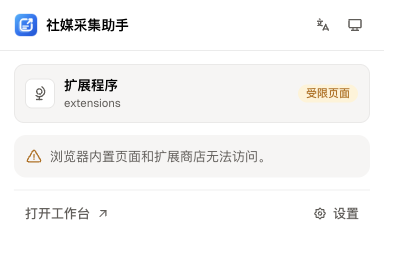

<h1 align="center">SocialExport</h1>

Exportiere Social-Media-Daten und speichere öffentliche Webseiten als Markdown.

<a href="README.md">English</a> · <a href="README.zh-CN.md">简体中文</a> · <a href="README.ja.md">日本語</a> · <a href="README.ko.md">한국어</a> · <a href="README.fr.md">Français</a> · <a href="README.de.md">Deutsch</a> · <a href="README.es.md">Español</a>

<a href="#download">Downloads</a> · <a href="#install">Installationsanleitung</a> · <a href="https://socialmediaexport.liduos.com/en">Offizielle Website</a>

## Downloads

| Browser | ZIP |
| --- | --- |
| Chrome | [ZIP](https://github.com/morsoli/social-media-export/releases/latest/download/social-export-chrome.zip) |
| Microsoft Edge | [ZIP](https://github.com/morsoli/social-media-export/releases/latest/download/social-export-edge.zip) |
| Firefox | [ZIP](https://github.com/morsoli/social-media-export/releases/latest/download/social-export-firefox.zip) |
| 360 Extreme, Quark, 360 Secure, Liebao und QQ Browser | [ZIP](https://github.com/morsoli/social-media-export/releases/latest/download/social-export-chromium.zip) |

[Ältere Testpakete](downloads/)

## Installationsanleitung

1. Lade die ZIP-Datei für deinen Browser herunter und entpacke sie. Aktiviere den Entwicklermodus in der Erweiterungsverwaltung und lade den Ordner mit `manifest.json`. Über das Erweiterungsmenü kannst du SocialExport anheften.
2. Öffne in Firefox `about:debugging#/runtime/this-firefox`, wähle **Temporäres Add-on laden** und öffne `manifest.json`. Nach jedem Firefox-Neustart muss das unsignierte Paket erneut geladen werden.
3. Öffne einen unterstützten Beitrag oder eine öffentliche Seite und wähle SocialExport. Social-Media-Daten lassen sich als CSV, Webseiten als Markdown-Datei oder ZIP speichern. Nach der Einrichtung kannst du Inhalte an Feishu/Lark oder Notion senden.

| Browser | Erweiterungsverwaltung |
| --- | --- |
| Chrome | `chrome://extensions` |
| Microsoft Edge | `edge://extensions` |
| Firefox | `about:debugging#/runtime/this-firefox` |
| 360 Extreme | Einstellungen → Erweiterungen |
| Quark | Erweiterungscenter → Erweiterungen verwalten |
| 360 Secure | Erweiterungen → Verwalten → Erweiterte Verwaltung (Windows) |
| Liebao | Optionen → Meine Apps (Windows) |
| QQ Browser | Erweiterungen → Erweiterungen verwalten |

Ob entpackte Ordner geladen werden können und Manifest V3 unterstützt wird, hängt von der Browserversion ab. Ein Menü, das nur CRX-Dateien akzeptiert, kann die ZIP-Datei nicht laden.

[Installationsanleitung ↗](https://socialmediaexport.liduos.com/en/guide)
