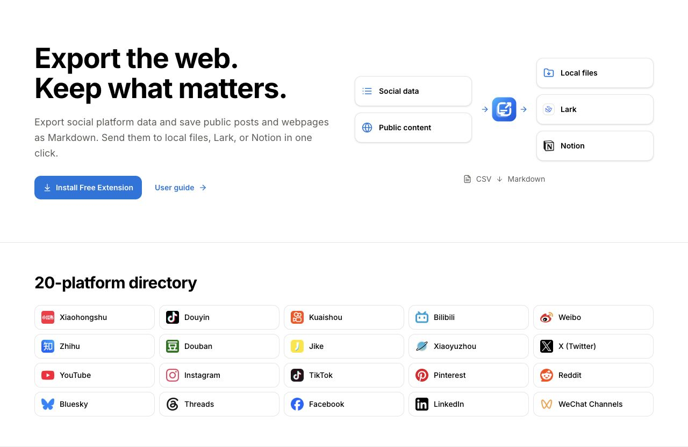

<h1 align="center">SocialMediaExport</h1>

Exportiere Social-Media-Daten und speichere öffentliche Webseiten als Markdown.

<a href="README.md">English</a> · <a href="README.zh-CN.md">简体中文</a> · <a href="README.ja.md">日本語</a> · <a href="README.ko.md">한국어</a> · <a href="README.fr.md">Français</a> · <a href="README.de.md">Deutsch</a> · <a href="README.es.md">Español</a>

<a href="#download">Downloads</a> · <a href="guide/GUIDE.de.md">Installationsanleitung</a> · <a href="https://socialmediaexport.liduos.com/en">Offizielle Website</a>

Eine kostenlose Browser-Erweiterung für Social-Media-Recherche und Web-Clipping mit lokaler Verarbeitung.

## Zwei Exportmöglichkeiten

### Social-Media-Daten

Exportiere Beiträge, Kommentare, Angaben zu Profilen und verfügbare Interaktionsdaten als CSV. Öffne CSV-Dateien für Recherche und Berichte in einer Tabellenkalkulation. Welche Felder verfügbar sind, hängt von Plattform und Seitentyp ab.

#### Fünf Erfassungsbereiche

1. **Medien** — Speichere verfügbare Videos, Audiodateien, Originalbilder und Titelbilder.
2. **Beitragsdaten** — Exportiere ID, URL, Titel, Text, Autor, Veröffentlichungsdatum und verfügbare Interaktionswerte.
3. **Kommentare** — Exportiere Text, Autor, Zeitpunkt und verfügbare Antworten.
4. **Creator-Profil** — Erfasse Profil-URL, Nutzernamen, Kurzbiografie, Verifizierung und verfügbare Follower-Zahlen.
5. **Creator-Beiträge** — Erstelle aus einem Profil oder einer unterstützten Sammlung eine Liste mit URLs, Titeln, Datumsangaben und verfügbaren Kennzahlen.

Verfügbare Felder hängen von Plattform und Seitentyp ab. Strukturierte Daten lassen sich als CSV exportieren.

### Öffentliche Webinhalte

Speichere öffentliche Webseiten und Beiträge als bearbeitbares Markdown, auf Wunsch mit verfügbaren Bildern in einer ZIP-Datei. Überschriften, Links und lesbarer Text bleiben im Markdown bearbeitbar. Verfügbare Bilder lassen sich in einer ZIP-Datei bündeln.

## Exportziele

Speichere lokal oder exportiere Inhalte in Feishu/Lark Base und Docs oder in Notion-Datenbanken und -Seiten. Der lokale Export läuft im Browser und erfordert kein SocialMediaExport-Konto.

## Plattformen und Kompatibilität

Unterstützt geeignete Seiten etwa auf YouTube, Instagram, TikTok, X, Reddit, Bilibili und Xiaohongshu.

## Downloads

| Browser | ZIP |
| --- | --- |
| Chrome | [ZIP](https://github.com/morsoli/social-media-export/releases/latest/download/social-export-chrome.zip) |
| Microsoft Edge | [ZIP](https://github.com/morsoli/social-media-export/releases/latest/download/social-export-edge.zip) |
| Firefox | [ZIP](https://github.com/morsoli/social-media-export/releases/latest/download/social-export-firefox.zip) |
| 360 Extreme, Quark, 360 Secure, Liebao und QQ Browser | [ZIP](https://github.com/morsoli/social-media-export/releases/latest/download/social-export-chromium.zip) |

**[SocialMediaExport auf der offiziellen Website entdecken](https://socialmediaexport.liduos.com/)**
