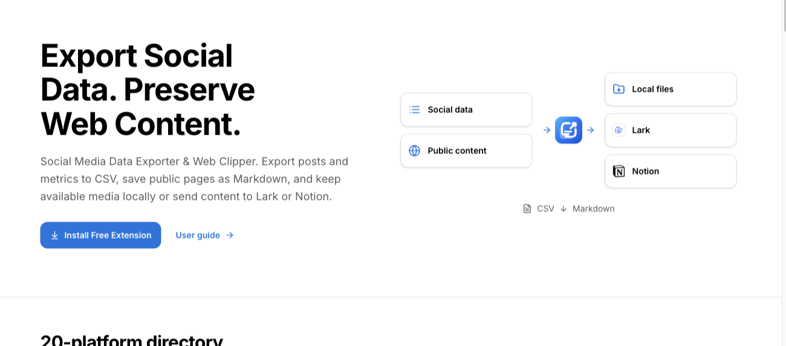

<h1 align="center">SocialExport</h1>

SNS データをエクスポートし、公開ウェブページを Markdown で保存。

<a href="README.md">English</a> · <a href="README.zh-CN.md">简体中文</a> · <a href="README.ja.md">日本語</a> · <a href="README.ko.md">한국어</a> · <a href="README.fr.md">Français</a> · <a href="README.de.md">Deutsch</a> · <a href="README.es.md">Español</a>

<a href="#download">ダウンロード</a> · <a href="guide/GUIDE.ja.md">インストールガイド</a> · <a href="https://socialexport.app/en">公式サイト</a>

SNS リサーチとウェブクリップに使える、無料のローカルファースト型ブラウザー拡張機能です。

## エクスポートできる内容

### SNS データ

対応する SNS の投稿、コメント、投稿者情報、反応数を CSV に出力できます。 CSV を表計算ツールで開いて調査や集計に活用できます。出力項目はサービスとページの種類によって異なります。

#### 5 つの収集項目

1. **投稿メディア** — 取得できる動画、音声、元画像、カバーを保存。
2. **投稿データ** — ID、URL、タイトル、本文、投稿者、公開日時と利用可能な反応数を出力。
3. **コメント** — 本文、投稿者、日時、および取得できる返信を出力。
4. **クリエイタープロフィール** — URL、アカウント名、自己紹介、認証情報、フォロワー数などを収集。
5. **クリエイターの投稿一覧** — プロフィールや対応するコレクションの投稿 URL、タイトル、日時と利用可能な指標を一覧化。

収集できる項目はサービスとページの種類によって異なります。構造化データは CSV で出力できます。

### 公開ウェブコンテンツ

公開ウェブページと投稿を編集可能な Markdown で保存し、取得できる画像を ZIP にまとめられます。 見出し、リンク、本文を編集可能な Markdown にまとめ、取得できる画像は ZIP に保存できます。

ウェブ記事や投稿から読み取れる見出し、リンク、表、コード、数式などを保持します。

### AI チャットのエクスポート

閲覧できる会話や共有ページから Markdown をコピーし、Markdown ファイルまたは ZIP に保存できます。ログインが必要な場合は元のサービスでログインしてください。

ChatGPT, Claude, Gemini, Google AI Studio, DeepSeek, Kimi, Doubao, Tencent Yuanbao, Qwen, Zhipu (ChatGLM), Grok, Perplexity.

## 保存先

SNS データは CSV、ウェブクリップと AI 会話は Markdown または ZIP で保存できます。設定後は Feishu/Lark の Base・Docs、Notion のデータベース・ページへ送信できます。

Obsidian の URI モードで Markdown ノートを開けます。画像を保管庫に保存する場合は、Obsidian Local REST API を設定し画像同期を有効にします。

## 対応プラットフォーム

v0.1.1 では次の 20 の SNS に対応します。取得できる項目やメディアはサービスとページで異なります。

| | | | |
| --- | --- | --- | --- |
|  RED (Xiaohongshu) |  Douyin |  Kuaishou |  Bilibili |
|  Weibo |  Zhihu |  Douban |  Jike |
|  Xiaoyuzhou |  X (Twitter) |  YouTube |  Instagram |
|  TikTok |  Pinterest |  Reddit |  Bluesky |
|  Threads |  Facebook |  LinkedIn |  Substack |

## プライバシーとアクセス

抽出とローカル保存はブラウザー内で行われ、SocialExport アカウントは不要です。元のサービスのアクセス権、利用規約、著作権、プライバシーを尊重してください。

## ダウンロード

最新版には 8 種類のデスクトップブラウザー向けの ZIP が 4 つあります。Chromium 系ブラウザーでは展開済みの Manifest V3 拡張機能に対応するバージョンが必要です。署名されていない Firefox 版は再起動後に再読み込みが必要です。

| ブラウザー | ZIP |
| --- | --- |
| Chrome | [ZIP](https://github.com/morsoli/social-media-export/releases/latest/download/social-export-chrome.zip) |
| Microsoft Edge | [ZIP](https://github.com/morsoli/social-media-export/releases/latest/download/social-export-edge.zip) |
| Firefox | [ZIP](https://github.com/morsoli/social-media-export/releases/latest/download/social-export-firefox.zip) |
| 360 Extreme、Quark、360 Secure、Liebao、QQ Browser | [ZIP](https://github.com/morsoli/social-media-export/releases/latest/download/social-export-chromium.zip) |

**[SocialExport の公式サイトへ](https://socialexport.app/)**
