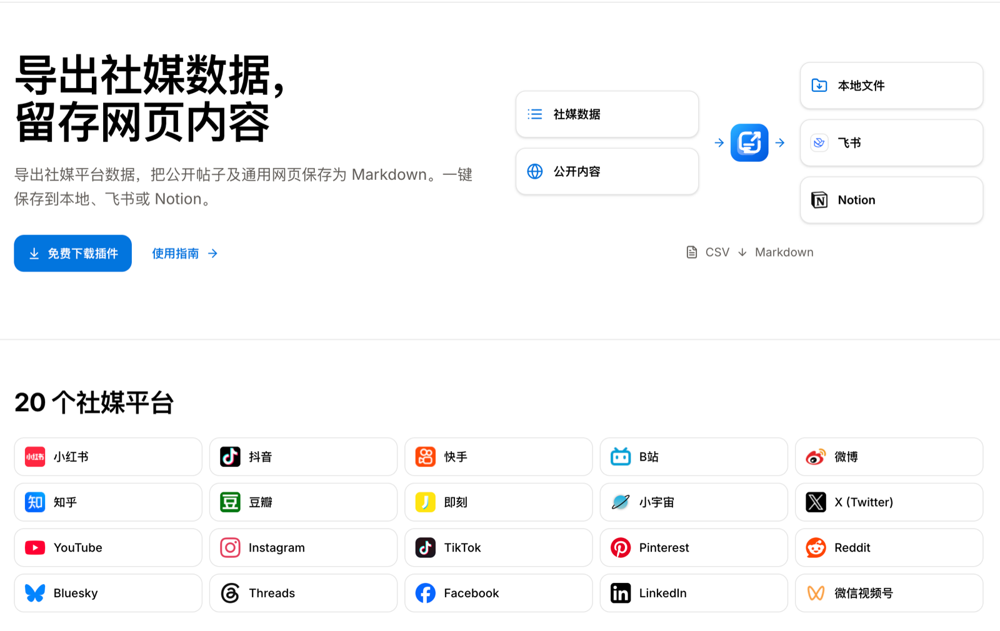

<h1 align="center">SocialExport</h1>

소셜 미디어 데이터를 내보내고 공개 웹 콘텐츠를 Markdown으로 저장하세요.

<a href="README.md">English</a> · <a href="README.zh-CN.md">简体中文</a> · <a href="README.ja.md">日本語</a> · <a href="README.ko.md">한국어</a> · <a href="README.fr.md">Français</a> · <a href="README.de.md">Deutsch</a> · <a href="README.es.md">Español</a>

<a href="#download">다운로드</a> · <a href="guide/GUIDE.ko.md">설치 가이드</a> · <a href="https://socialmediaexport.liduos.com/en">공식 웹사이트</a>

소셜 미디어 분석과 웹 클리핑을 위한 무료 로컬 우선 브라우저 확장 프로그램입니다.

## 두 가지 내보내기 방식

### 소셜 미디어 데이터

지원 플랫폼의 게시물, 댓글, 작성자 정보, 반응 수치를 CSV로 내보냅니다. CSV를 스프레드시트에서 열어 조사나 보고서에 활용할 수 있습니다. 제공되는 필드는 플랫폼과 페이지 유형에 따라 다릅니다.

### 공개 웹 콘텐츠

공개 웹페이지와 게시물을 편집 가능한 Markdown으로 저장하고, 다운로드 가능한 이미지를 ZIP에 담습니다. 제목과 링크를 유지한 편집 가능한 Markdown으로 저장하고, 내려받을 수 있는 이미지는 ZIP에 담을 수 있습니다.

## 내보내기 대상

기기에 저장하거나 Feishu/Lark의 Base와 Docs, Notion의 데이터베이스와 페이지에 보낼 수 있습니다. 로컬 내보내기는 브라우저에서 실행되며 SocialExport 계정이 필요하지 않습니다.

## 지원 플랫폼

YouTube, Instagram, TikTok, X, Reddit, Bilibili, Xiaohongshu 등에서 지원되는 페이지를 사용할 수 있습니다.

## 다운로드

| 브라우저 | ZIP |
| --- | --- |
| Chrome | [ZIP](https://github.com/morsoli/social-media-export/releases/latest/download/social-export-chrome.zip) |
| Microsoft Edge | [ZIP](https://github.com/morsoli/social-media-export/releases/latest/download/social-export-edge.zip) |
| Firefox | [ZIP](https://github.com/morsoli/social-media-export/releases/latest/download/social-export-firefox.zip) |
| 360 Extreme, Quark, 360 Secure, Liebao, QQ Browser | [ZIP](https://github.com/morsoli/social-media-export/releases/latest/download/social-export-chromium.zip) |

**[SocialExport 공식 웹사이트](https://socialmediaexport.liduos.com/)**
