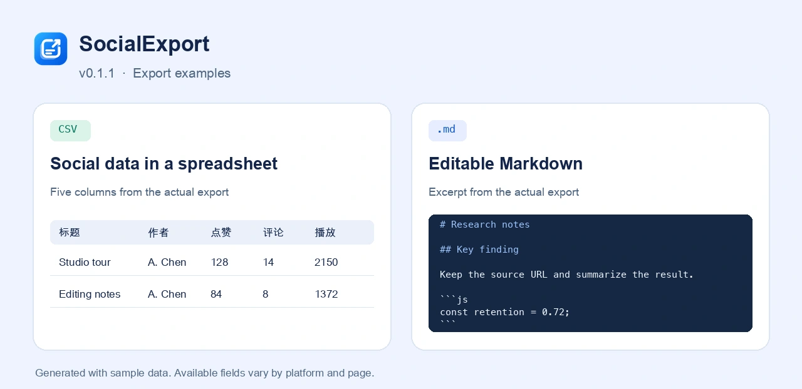

<h1 align="center">SocialExport – Social Media Exporter</h1>

Export Social Data. Preserve Web Content.

<a href="README.md">English</a> · <a href="README.zh-CN.md">简体中文</a> · <a href="README.ja.md">日本語</a> · <a href="README.ko.md">한국어</a> · <a href="README.fr.md">Français</a> · <a href="README.de.md">Deutsch</a> · <a href="README.es.md">Español</a>

<a href="#download">Downloads</a> · <a href="guide/GUIDE.md">Installation guide</a> · <a href="https://socialexport.app/en">Official website</a>

Analyze posts and comments in a spreadsheet, save public webpages as Markdown, or keep an AI conversation for later. SocialExport extracts the content in your browser and lets you choose where the result goes.

## What you can export

### Social media data

Export posts, comments, and creator records as Excel-compatible UTF-8 CSV, or send them to Feishu/Lark Base or a Notion database after configuration.

#### Five collection dimensions

1. **Post media**. Available video (MP4) and audio (MP3) files, original images, covers, Live Photo clips and background music. Image collections can be downloaded as a ZIP.

2. **Post data**. Post ID, platform, type, title, body, available OCR text, link, author name, ID, handle, profile, bio and follower count, collection, hashtags, and publish, update and capture dates. Metrics can include plays, likes, saves, comments and shares. Media columns can include cover, image, Live Photo, video and music URLs, plus duration and IP region where available.

3. **Post comments**. Comment ID and text, author name, ID, handle and profile link, comment and capture times, likes, reply count, IP region and attached image URLs, and source post ID, title and URL. Available replies include their level, parent comment ID and reply target.

4. **Creator profiles**. Creator ID, display name, handle, profile link, bio, verification, avatar link, gender, IP region and capture time, plus available follower, following, post and total interaction counts.

5. **Creator posts**. Post rows from supported profiles or collections, using the post-data fields above. Compare titles, URLs, publishing dates, collections, engagement and available media across a creator’s work.

Available fields and media vary by platform and page type. Media downloads as files; structured data can be exported as CSV.

### Public web content

Save public webpages and posts as editable Markdown or as a ZIP with available images. Clipping preserves readable headings, links, lists, tables, code blocks, and formulas when the page exposes them. It works with readable web articles, social posts, and supported document pages.

### Export AI conversations

Export a readable conversation as Markdown or a ZIP, or copy the Markdown. Open the conversation or a readable share link on its original service. If access requires sign-in, sign in there first. Only content available to the browser can be exported.

| | | | |
| --- | --- | --- | --- |
|  ChatGPT |  Claude |  Gemini |  Google AI Studio |
|  DeepSeek |  Kimi |  Doubao |  Tencent Yuanbao |
|  Qwen |  Zhipu (ChatGLM) |  Grok |  Perplexity |

## Export destinations

Download CSV for social data, Markdown or ZIP for clipped content and AI conversations, and the original media where available. Configure Feishu/Lark or Notion to save social data to a Base table or database, and clips or conversations to Docs or pages.

Save clips and AI conversations to an Obsidian vault. URI mode opens a Markdown note in Obsidian. To save supported images into the vault as well, configure the Obsidian Local REST API and enable image syncing.

## Platforms and compatibility

Check the [platform directory](https://socialexport.app/en/platforms) for the 20 social platforms covered in v0.1.1. Features, fields, replies, and media vary by page and platform.

| | | | |
| --- | --- | --- | --- |
|  RED (Xiaohongshu) |  Douyin |  Kuaishou |  Bilibili |
|  Weibo |  Zhihu |  Douban |  Jike |
|  Xiaoyuzhou |  X (Twitter) |  YouTube |  Instagram |
|  TikTok |  Pinterest |  Reddit |  Bluesky |
|  Threads |  Facebook |  LinkedIn |  Substack |

## Use cases

- **Social media managers and creators** — Track content performance and review audience feedback.
- **Researchers and data analysts** — Collect posts, comments, and creator activity for spreadsheet analysis.
- **Knowledge management** — Preserve useful articles, posts, and media in local files, Feishu/Lark, or Notion.

## Privacy and access

Extraction and local exports run in the browser without a SocialExport account. Sending content to Feishu/Lark or Notion uses the destination you configure. Respect source-site access requirements, platform rules, copyright, and privacy.

## Downloads

The latest release provides four ZIPs for eight desktop browsers. Chrome and Edge load unpacked extensions, and the five other Chromium browsers share a package where their browser version supports unpacked Manifest V3. Firefox uses an unsigned temporary add-on that must be loaded again after restarting.

| Browser | ZIP |
| --- | --- |
| Chrome | [ZIP](https://github.com/morsoli/social-media-export/releases/latest/download/social-export-chrome.zip) |
| Microsoft Edge | [ZIP](https://github.com/morsoli/social-media-export/releases/latest/download/social-export-edge.zip) |
| Firefox | [ZIP](https://github.com/morsoli/social-media-export/releases/latest/download/social-export-firefox.zip) |
| 360 Extreme, Quark, 360 Secure, Liebao and QQ Browser | [ZIP](https://github.com/morsoli/social-media-export/releases/latest/download/social-export-chromium.zip) |

**[Explore SocialExport on the official website](https://socialexport.app/)**
