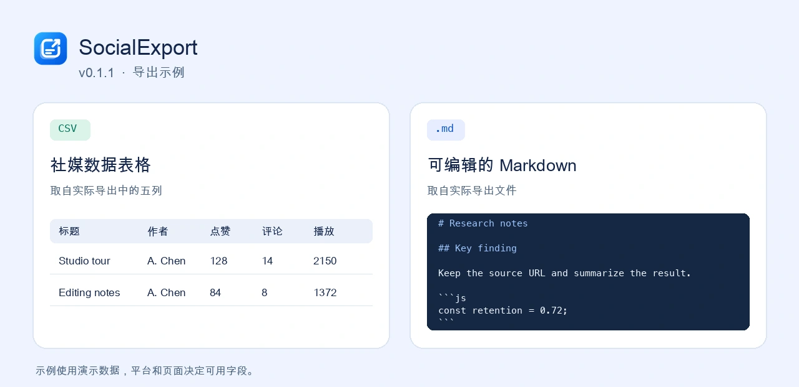

<h1 align="center">SocialExport 社媒导出助手</h1>

导出社媒数据，留存网页内容

<a href="README.md">English</a> · <a href="README.zh-CN.md">简体中文</a> · <a href="README.ja.md">日本語</a> · <a href="README.ko.md">한국어</a> · <a href="README.fr.md">Français</a> · <a href="README.de.md">Deutsch</a> · <a href="README.es.md">Español</a>

<a href="#download">下载</a> · <a href="guide/GUIDE.zh-CN.md">安装指南</a> · <a href="https://socialexport.app">官方网站</a>

把帖子和评论整理成表格，把网页和 AI 对话保存为 Markdown。SocialExport 在浏览器内提取内容，你可以下载文件，也可以发送到自己配置的工作区。

## 可以导出什么

### 社媒数据导出

作品、评论和创作者数据可导出为带 UTF-8 BOM 的 CSV，可在 Excel 或其他表格工具中打开。配置飞书或 Notion 后，也可以写入多维表格或数据库。

#### 五个数据采集维度

1. **作品媒体**。可获取的视频（MP4）、音频（MP3）、原图、封面，以及原页面提供的实况片段和背景音乐。多张原图可打包为 ZIP。

2. **作品数据**。作品 ID、平台、类型、标题、正文、可获取的 OCR 内容、来源链接、作者昵称／ID／账号／主页／简介／粉丝数、所属合集、话题标签，以及发布、更新和采集时间。互动指标包括可读取的播放、点赞、收藏、评论和分享数；也可包含封面、图片、实况、视频、音乐链接、时长和可获取的 IP 属地。

3. **作品评论**。评论 ID、正文、评论者昵称／ID／账号／主页、评论和采集时间、点赞数、子评论数、IP 属地、配图链接，以及所属作品的 ID、标题和链接。平台可提供回复时，还可区分评论层级，并记录一级评论 ID 和回复对象。

4. **创作者资料**。创作者 ID、昵称、平台账号、主页链接、个人简介、认证信息、头像链接、性别、IP 属地和采集时间，以及可读取的粉丝数、关注数、作品总数和获赞与收藏。

5. **创作者作品**。从支持的创作者主页或合集导出作品清单，复用作品数据字段。可按标题、链接、发布时间、合集、互动指标和媒体链接整理同一创作者的作品。

可获取的字段和媒体因平台及页面类型而异。媒体保存为文件，结构化数据可导出为 CSV。

### 公开网页剪藏

将公开网页和帖子保存为可编辑的 Markdown，或下载含可获取图片的 ZIP。网页剪藏可保留可读取的标题层级、链接、列表、表格、代码块和公式。适用于公开网页、社媒帖子和受支持的文档页面。

### AI 对话导出

打开原站的对话或可读取的分享页，可复制 Markdown，或下载 Markdown 文件及 ZIP。页面要求登录时，先在原站登录。仅能导出浏览器可读取的内容。

| | | | |
| --- | --- | --- | --- |
|  ChatGPT |  Claude |  Gemini |  Google AI Studio |
|  DeepSeek |  Kimi |  豆包 |  腾讯元宝 |
|  千问 |  智谱清言 |  Grok |  Perplexity |

## 导出到哪里

社媒结构化数据可下载为 CSV，网页剪藏和 AI 对话可下载为 Markdown 或 ZIP，媒体可单独保存。配置飞书或 Notion 后，社媒数据可写入多维表格或数据库，网页和对话可保存为云文档或页面。

网页剪藏和 AI 对话也可保存到 Obsidian。URI 模式在 Obsidian 打开 Markdown 笔记。需要把可获取的图片一起写入笔记库时，请配置 Obsidian Local REST API，并启用图片同步。

## 平台与兼容性

v0.1.1 覆盖下列 20 个社媒平台。可获取的字段、回复、媒体和功能因平台及页面而异。详见[平台目录](https://socialexport.app/platforms)。

| | | | |
| --- | --- | --- | --- |
|  小红书 |  抖音 |  快手 |  哔哩哔哩 |
|  微博 |  知乎 |  豆瓣 |  即刻 |
|  小宇宙 |  X（Twitter） |  YouTube |  Instagram |
|  TikTok |  Pinterest |  Reddit |  Bluesky |
|  Threads |  Facebook |  LinkedIn |  Substack |

## 适用场景

- **创作者与社媒运营**：整理作品表现、用户互动和评论反馈。
- **研究与数据分析**：收集公开帖子、评论和创作者信息，在表格工具中分析。
- **资料留存与知识管理**：将公开文章、帖子和可获取的媒体保存到本地、飞书或 Notion。

## 隐私与访问权限

内容解析和本地导出在浏览器内运行，无需注册 SocialExport 账号。发送到飞书或 Notion 时，内容会发往你配置的目标。使用时请遵守原站访问权限、平台规则、版权及隐私要求。

## 下载

最新版本提供四个 ZIP，覆盖八种桌面浏览器。Chrome 和 Edge 加载解压目录。其余五种 Chromium 浏览器共用安装包，须支持加载解压的 Manifest V3 扩展。Firefox 为未签名临时安装包，重启后需重新加载。

| 浏览器 | ZIP |
| --- | --- |
| Chrome | [ZIP](https://github.com/morsoli/social-media-export/releases/latest/download/social-export-chrome.zip) |
| Microsoft Edge | [ZIP](https://github.com/morsoli/social-media-export/releases/latest/download/social-export-edge.zip) |
| Firefox | [ZIP](https://github.com/morsoli/social-media-export/releases/latest/download/social-export-firefox.zip) |
| 360 极速、夸克、360 安全、猎豹和 QQ 浏览器 | [ZIP](https://github.com/morsoli/social-media-export/releases/latest/download/social-export-chromium.zip) |

**[打开社媒导出助手官网](https://socialexport.app/)**
