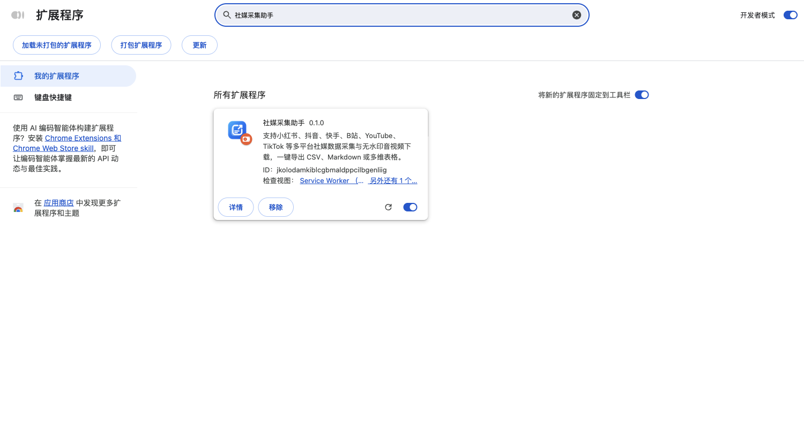

[SocialExport](../README.es.md) · [GitHub Releases](https://github.com/morsoli/social-media-export/releases/latest)

# Guía de instalación

### Descargas

| Navegador | ZIP |
| --- | --- |
| Chrome | [ZIP](https://github.com/morsoli/social-media-export/releases/latest/download/social-export-chrome.zip) |
| Microsoft Edge | [ZIP](https://github.com/morsoli/social-media-export/releases/latest/download/social-export-edge.zip) |
| Firefox | [ZIP](https://github.com/morsoli/social-media-export/releases/latest/download/social-export-firefox.zip) |
| 360 Extreme, Quark, 360 Secure, Liebao y QQ Browser | [ZIP](https://github.com/morsoli/social-media-export/releases/latest/download/social-export-chromium.zip) |

1. Descarga y extrae el ZIP de tu navegador. Activa el modo de desarrollador en el administrador de extensiones y carga la carpeta que contiene `manifest.json`. Fija SocialExport desde el menú de extensiones.
2. En Firefox, abre `about:debugging#/runtime/this-firefox`, elige **Cargar complemento temporal** y selecciona `manifest.json`. Vuelve a cargar el paquete sin firmar al reiniciar Firefox.
3. Abre una publicación compatible o una página pública y selecciona SocialExport. Exporta los datos sociales a CSV o guarda la página como Markdown o ZIP. Tras configurar la conexión, también puedes enviar el contenido a Feishu/Lark o Notion.

| Navegador | Administrador de extensiones |
| --- | --- |
| Chrome | `chrome://extensions` |
| Microsoft Edge | `edge://extensions` |
| Firefox | `about:debugging#/runtime/this-firefox` |
| 360 Extreme | Configuración → Extensiones |
| Quark | Centro de extensiones → Administrar extensiones |
| 360 Secure | Extensiones → Administrar → Administración avanzada (Windows) |
| Liebao | Opciones → Mis aplicaciones (Windows) |
| QQ Browser | Extensiones → Administrar extensiones |

La carga de carpetas descomprimidas y la compatibilidad con Manifest V3 dependen de la versión. Si el menú solo admite CRX, el ZIP no se puede cargar por esa vía.

[Guía de instalación ↗](https://socialexport.app/en/guide)
